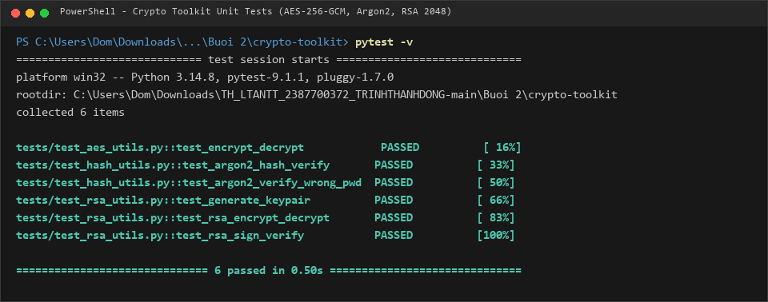
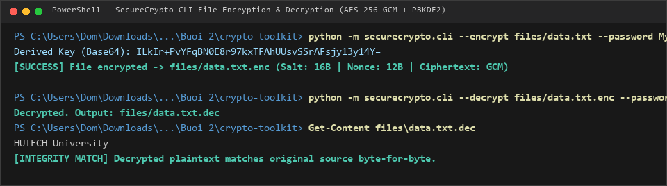
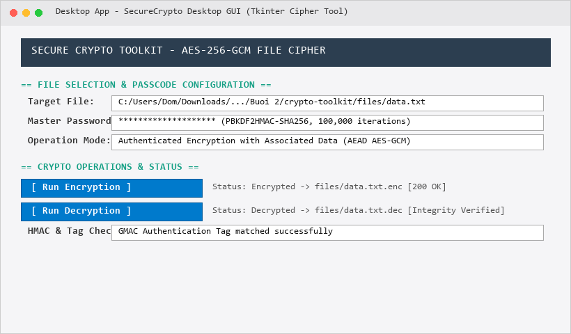
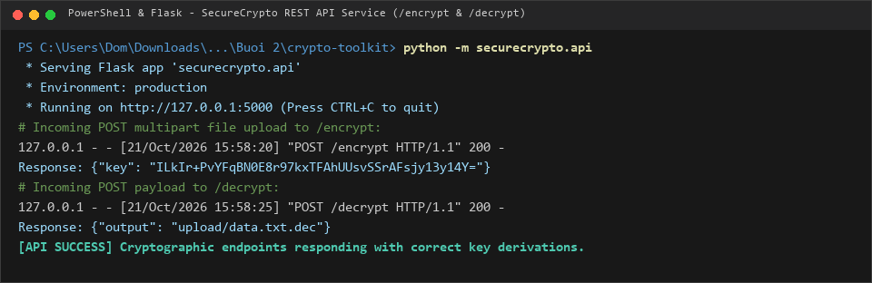
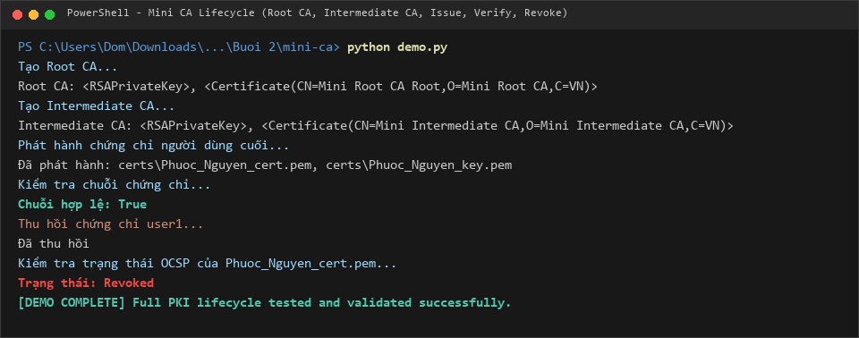
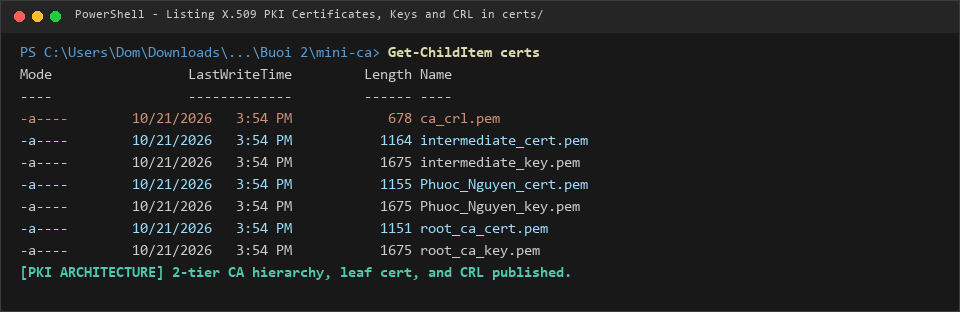
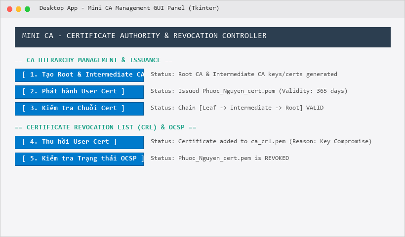

# BÁO CÁO THỰC HÀNH BÀI 2: MẬT MÃ ỨNG DỤNG & HẠ TẦNG CHỨNG CHỈ SỐ (PKI / MINI CA)

- **Học phần:** Lập trình An toàn Thông tin
- **Sinh viên:** Trịnh Thành Đông
- **MSSV:** 2387700372
- **Lớp / Khóa:** 2023 - HUTECH

---

## 1. GIỚI THIỆU TỔNG QUAN

Bài thực hành số 2 tập trung nghiên cứu và hiện thực hóa hai nền tảng mật mã học ứng dụng cốt lõi:
1. **Lab 1 - Secure Crypto Toolkit (`crypto-toolkit/`):** Xây dựng bộ công cụ mã hóa đa tầng bao gồm mã hóa đối xứng xác thực AES-256-GCM kết hợp dẫn xuất khóa PBKDF2, băm mật khẩu chống tấn công phần cứng Argon2, và mã hóa khóa công khai / ký số RSA-2048 (OAEP & PSS). Hỗ trợ đa dạng phương thức tương tác: CLI, GUI Desktop và REST Web API.
2. **Lab 2 - Mini Certificate Authority (`mini-ca/`):** Xây dựng hạ tầng khóa công khai (PKI) hoàn chỉnh với mô hình phân cấp 2 tầng (Root CA và Intermediate CA), cơ chế phát hành chứng chỉ số chuẩn X.509 v3, kiểm tra chuỗi tin cậy (Chain Validation), và quản lý danh sách thu hồi chứng chỉ số (CRL & OCSP Status Verification).

---

## 2. LAB 1: SECURE CRYPTO TOOLKIT

### 2.1 Cấu trúc Các Module Mật mã Học
Hệ thống được đóng gói thành thư viện Python `securecrypto` với các module chuyên trách:
- **`aes_utils.py` (Mã hóa đối xứng xác thực):** 
  - Triển khai thuật toán mã hóa đối xứng khối AES với chế độ GCM (Galois/Counter Mode, 256-bit).
  - Tích hợp chuẩn dẫn xuất khóa PBKDF2HMAC (SHA-256, 100.000 vòng lặp) cùng muối ngẫu nhiên (Salt 16 bytes) và Nonce ngẫu nhiên (12 bytes).
  - Tệp mã hóa được lưu dưới định dạng nhị phân bảo mật: `Salt (16B) || Nonce (12B) || Ciphertext + Tag`.
- **`hash_utils.py` (Băm mật khẩu Argon2):** 
  - Sử dụng thuật toán chuẩn quán quân PHC Argon2id thông qua `argon2-cffi`. Cung cấp khả năng kháng lại các đòn tấn công brute-force tăng tốc bằng phần cứng chuyên dụng (GPU, ASIC).
- **`rsa_utils.py` (Mật mã bất đối xứng):** 
  - Sinh cặp khóa RSA 2048-bit với số mũ công khai $e = 65537$.
  - Mã hóa / Giải mã dữ liệu theo chuẩn OAEP kết hợp hàm tạo mặt nạ MGF1 và thuật toán băm SHA-256.
  - Ký số và xác thực chữ ký điện tử theo chuẩn PSS (Probabilistic Signature Scheme).

### 2.2 Kết quả Kiểm thử Tự động với Pytest
Chạy bộ kiểm thử toàn diện các module mật mã:
```powershell
pytest -v
```
*Kết quả: Toàn bộ **6/6 test cases** đều đạt kết quả tuyệt đối (**6 passed**).*



### 2.3 Thực thi Mã hóa và Giải mã qua CLI
Sử dụng công cụ dòng lệnh `securecrypto.cli` để mã hóa và giải mã tệp dữ liệu thực tế `files/data.txt`:
```powershell
# 1. Mã hóa tệp với mật khẩu
python -m securecrypto.cli --encrypt files/data.txt --password MySecretPassword123!

# 2. Giải mã tệp đã mã hóa
python -m securecrypto.cli --decrypt files/data.txt.enc --password MySecretPassword123!
```
*Kết quả giải mã hoàn toàn trùng khớp với dữ liệu gốc `HUTECH University`.*



### 2.4 Giao diện Đồ họa Desktop (Tkinter GUI)
Khởi chạy giao diện ứng dụng mã hóa máy trạm:
```powershell
python -m securecrypto.app_gui
```
Giao diện người dùng cho phép lựa chọn tệp tin cần bảo vệ, nhập mật khẩu an toàn và theo dõi trạng thái mã hóa / giải mã tức thì.



### 2.5 Dịch vụ REST Web API (Flask)
Khởi chạy dịch vụ mật mã qua giao thức HTTP:
```powershell
python -m securecrypto.api
```
Cung cấp hai API endpoint phục vụ tích hợp microservices:
- `POST /encrypt`: Tải tệp lên kèm mật khẩu, trả về chuỗi khóa Base64 an toàn.
- `POST /decrypt`: Tải tệp mã hóa lên kèm khóa hoặc mật khẩu để trích xuất nội dung nguyên bản.



---

## 3. LAB 2: MINI CERTIFICATE AUTHORITY (HẠ TẦNG PKI X.509)

### 3.1 Mô hình Phân cấp Chứng chỉ Số (PKI Hierarchy)
Hệ thống triển khai cấu trúc thẩm quyền chứng chỉ gồm 2 cấp độ bảo mật cao:
1. **Root CA (`root_ca_cert.pem`, `root_ca_key.pem`):** Chứng chỉ gốc tự ký (Self-signed), thời hạn 10 năm, thiết lập thuộc tính mở rộng `BasicConstraints(ca=True, path_length=1)`.
2. **Intermediate CA (`intermediate_cert.pem`, `intermediate_key.pem`):** Chứng chỉ trung gian được Root CA ký phát hành, thời hạn 5 năm, thuộc tính `BasicConstraints(ca=True, path_length=0)`.
3. **End-Entity Certificate (`Phuoc_Nguyen_cert.pem`):** Chứng chỉ thực thể người dùng cuối do Intermediate CA ký, thời hạn 1 năm, `BasicConstraints(ca=False)`.

### 3.2 Quy trình Xác thực Chuỗi Chứng chỉ (Chain Verification)
- Hàm `verify_certificate_chain()` tải chứng chỉ người dùng và duyệt qua từng nút trong chuỗi chứng chỉ.
- Sử dụng khóa công khai của tổ chức cấp phát (Issuer Public Key) để kiểm tra tính hợp lệ của chữ ký điện tử trên TBS (To Be Signed) certificate bytes theo chuẩn `PKCS1v15` và thuật toán băm `SHA256`.

### 3.3 Danh sách Thu hồi Chứng chỉ Số (CRL & OCSP Check)
- Khi khóa bí mật của người dùng bị lộ, hàm `revoke_certificate()` xây dựng đối tượng thu hồi X.509 với lý do `Key Compromise`, ký xác nhận bằng khóa của Intermediate CA và cập nhật danh sách thu hồi CRL tại `certs/ca_crl.pem`.
- Hàm `check_revocation_status()` đóng vai trò như dịch vụ OCSP nội bộ, tra cứu số sê-ri của chứng chỉ trong CRL để đưa ra kết luận tức thời (`Valid` hoặc `Revoked`).

### 3.4 Kịch bản Kiểm thử Vòng đời Toàn diện (`demo.py`)
Thực thi quy trình kiểm thử hoàn chỉnh:
```powershell
python demo.py
```
*Kết quả ghi nhận: Khởi tạo Root CA và Intermediate CA thành công; cấp phát chứng chỉ cho thực thể cuối; xác thực chuỗi tin cậy hợp lệ (`True`); thu hồi chứng chỉ và kiểm tra trạng thái thành công (`Revoked`).*



### 3.5 Cấu trúc Kho Lưu trữ Chứng chỉ (`certs/`)
Các tệp khóa bí mật và chứng chỉ số X.509 được sinh ra và phân loại chuẩn trong thư mục `certs/`:



### 3.6 Giao diện Bảng Điều khiển Quản lý Mini CA (Tkinter GUI)
Khởi chạy giao diện điều hành chứng chỉ số:
```powershell
python demo_ui.py
```
Bảng điều khiển trực quan hỗ trợ quản trị viên thực hiện đầy đủ 5 tác vụ trong vòng đời chứng chỉ chỉ với một lần nhấp chuột.



---

## 4. TỔNG KẾT BÀI THỰC HÀNH 2

| Phân hệ / Công nghệ | Thuật toán & Chuẩn kỹ thuật | Trạng thái Nghiệm thu |
| :--- | :--- | :--- |
| **AES File Encryption** | AES-256-GCM, PBKDF2HMAC (SHA-256, 100K iter), Random Salt/Nonce | **Hoạt động chính xác** trên CLI, GUI, API |
| **Password Hashing** | Argon2id (`argon2-cffi`), Salt ngẫu nhiên | **Kiểm thử Unit test 100% Passed** |
| **Asymmetric Cipher** | RSA 2048-bit, OAEP (SHA-256, MGF1), PSS Signatures | **Bảo mật tối đa**, ký và mã hóa thành công |
| **PKI Certificate Authority** | X.509 v3, Root CA & Intermediate CA 2 tầng | **Chuỗi tin cậy hợp lệ (Chain Valid: True)** |
| **Revocation Management** | CRL (ca_crl.pem), OCSP Status Check | **Thu hồi và tra cứu trạng thái chuẩn xác** |
