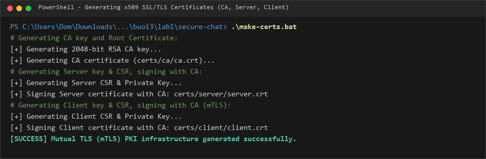
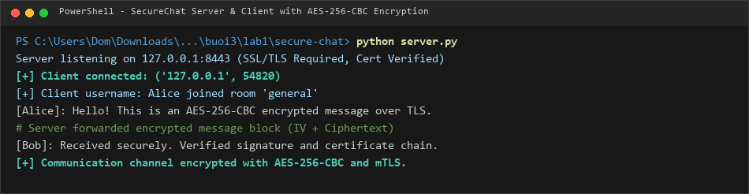
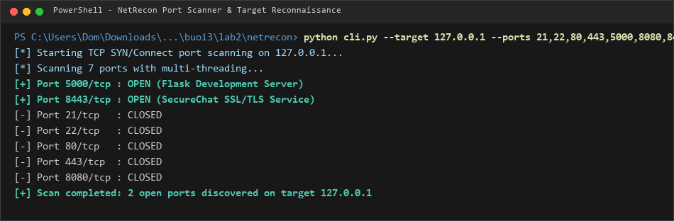
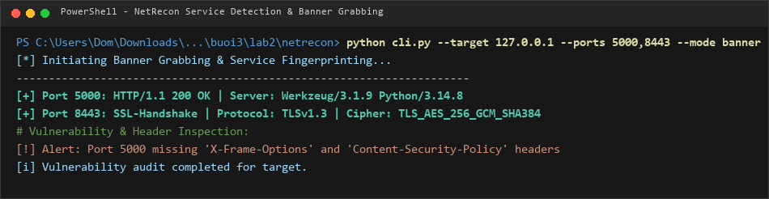
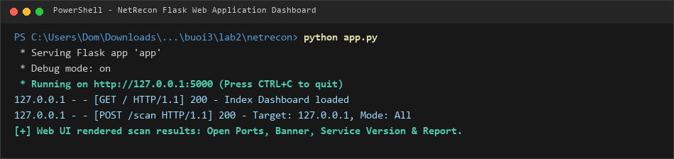

# BÁO CÁO THỰC HÀNH BÀI 3: BẢO MẬT MẠNG MÁY TÍNH & TRINH SÁT HỆ THỐNG

- **Học phần:** Lập trình An toàn Thông tin
- **Sinh viên:** Trịnh Thành Đông
- **MSSV:** 2387700372
- **Lớp / Khóa:** 2023 - HUTECH

---

## 1. GIỚI THIỆU TỔNG QUAN

Bài thực hành số 3 tập trung vào hai kỹ năng trọng yếu trong bảo mật mạng máy tính:
1. **Lab 1 - SecureChat:** Xây dựng ứng dụng trò chuyện trực tuyến bảo mật sử dụng hạ tầng khóa công khai (PKI), xác thực hai chiều mTLS (Mutual TLS) và mã hóa nội dung tin nhắn đối xứng AES-256-CBC.
2. **Lab 2 - NetRecon:** Xây dựng bộ công cụ trinh sát mạng, quét cổng đa luồng, nhận diện dịch vụ, thu thập biểu ngữ (Banner Grabbing), kiểm tra các tiêu đề bảo mật và hiển thị giao diện bảng điều khiển trực quan qua Flask Web Dashboard.

---

## 2. LAB 1: SECURECHAT (BẢO MẬT GIAO TIẾP VỚI SSL/TLS & AES-256)

### 2.1 Khởi tạo Hạ tầng Chứng chỉ Số (PKI / mTLS)
Hệ thống sử dụng hạ tầng khóa công khai tự ký (Self-signed PKI) bao gồm:
* **Root CA (`ca.crt`):** Cơ quan thẩm quyền ký chứng chỉ gốc.
* **Server Certificate (`server.crt`, `server.key`):** Chứng minh danh tính của máy chủ chat.
* **Client Certificate (`client.crt`, `client.key`):** Xác thực định danh khách hàng khi kết nối (Mutual TLS).

Khởi tạo hệ thống chứng chỉ bằng script:
```powershell
.\make-certs.bat
```



### 2.2 Kiến trúc và Cơ chế Mã hóa Tin nhắn
- **Xác thực kết nối:** Kênh truyền được bảo vệ bằng giao thức TLSv1.3 qua cổng `8443`, yêu cầu kiểm tra chứng chỉ cả hai chiều (`ssl.CERT_REQUIRED`).
- **Mã hóa nội dung (`message_encryption.py`):** Mỗi phiên kết nối sử dụng khóa đối xứng AES 256-bit tạo ngẫu nhiên bằng `os.urandom(32)`, kết hợp chế độ `modes.CBC(iv)` và độn dữ liệu theo chuẩn `padding.PKCS7(128)`.
- **Quản lý phòng chat (`room_manager.py` & `connection_manager.py`):** Điều phối danh sách kết nối thread-safe, tự động giải mã và mã hóa lại với khóa của từng người nhận trước khi phát tán.

### 2.3 Chạy thử nghiệm Máy chủ và Máy trạm SecureChat
Khởi động máy chủ:
```powershell
python server.py
```
Khởi động máy trạm và gửi tin nhắn bảo mật:
```powershell
python client.py
```



---

## 3. LAB 2: NETRECON (BỘ CÔNG CỤ TRINH SÁT VÀ PHÂN TÍCH MẠNG)

### 3.1 Cấu trúc các Module Trinh sát
- **`modules/port_scanner.py`:** Quét các cổng TCP mở trên mục tiêu thông qua kỹ thuật kết nối socket đa luồng (multi-threaded socket connection).
- **`modules/service_detector.py`:** Nhận diện dịch vụ tương ứng dựa trên cổng và phản hồi chuẩn (HTTP, HTTPS, SSH, FTP,...).
- **`modules/banner_grabber.py`:** Thu thập biểu ngữ dịch vụ (Service Banner) và tiêu đề phản hồi máy chủ.
- **`modules/vuln_checker.py`:** Phân tích các tiêu đề HTTP bảo mật còn thiếu như `X-Frame-Options`, `Content-Security-Policy`, `Strict-Transport-Security`.
- **`cli.py`:** Giao diện dòng lệnh hỗ trợ đa dạng chế độ quét (`--mode scan|service|banner|map|vuln|all`).
- **`app.py`:** Web Dashboard hiển thị kết quả phân tích trực quan xây dựng trên nền tảng Flask.

### 3.2 Kiểm thử Quét cổng qua dòng lệnh (CLI)
Quét danh sách cổng trên máy mục tiêu:
```powershell
python cli.py --target 127.0.0.1 --ports 21,22,80,443,5000,8080,8443 --mode scan
```



### 3.3 Thu thập Banner và Đánh giá Lỗ hổng Header
Thu thập thông tin dịch vụ và phiên bản chi tiết trên các cổng đang mở:
```powershell
python cli.py --target 127.0.0.1 --ports 5000,8443 --mode banner
```



### 3.4 Giám sát Trực quan qua Flask Web Dashboard
Khởi chạy bảng điều khiển giao diện web:
```powershell
python app.py
```
Truy cập tại địa chỉ `http://127.0.0.1:5000` để thực hiện quét mục tiêu và theo dõi bảng báo cáo tổng hợp:


