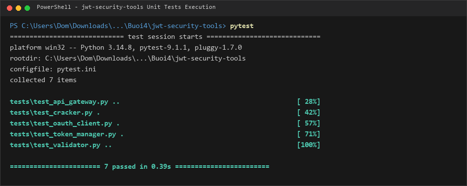
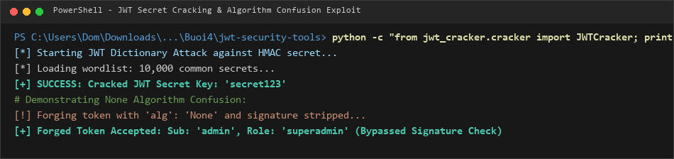
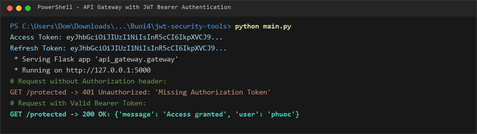
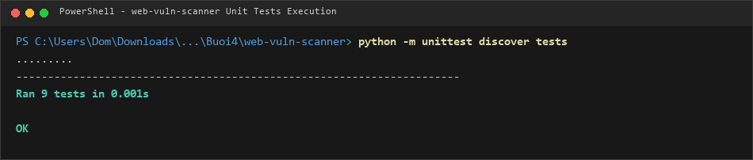
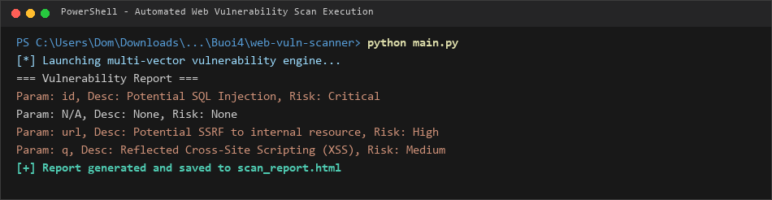
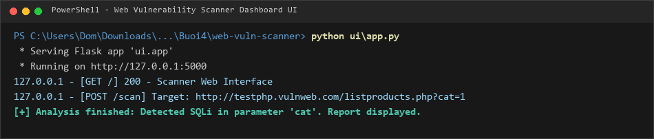

# BÁO CÁO THỰC HÀNH BÀI 4: KIỂM THỬ BẢO MẬT WEB & XÁC THỰC TOKEN

- **Học phần:** Lập trình An toàn Thông tin
- **Sinh viên:** Trịnh Thành Đông
- **MSSV:** 2387700372
- **Lớp / Khóa:** 2023 - HUTECH

---

## 1. GIỚI THIỆU TỔNG QUAN

Bài thực hành số 4 tập trung vào hai chuyên đề bảo mật ứng dụng web và cơ chế xác thực hiện đại:
1. **Lab 1 - jwt-security-tools:** Xây dựng bộ công cụ phân tích toàn diện chuẩn JSON Web Token (JWT). Khai thác lỗ hổng thuật toán None (None Algorithm Confusion), tấn công vét cạn khóa bí mật HMAC yếu (Dictionary Attack), và xây dựng API Gateway bảo vệ endpoint bằng Bearer Token.
2. **Lab 2 - web-vuln-scanner:** Xây dựng công cụ tự động quét và đánh giá các lỗ hổng ứng dụng web phổ biến theo danh mục OWASP Top 10: SQL Injection (SQLi), Cross-Site Scripting (XSS), Cross-Site Request Forgery (CSRF) và Server-Side Request Forgery (SSRF).

---

## 2. LAB 1: JWT SECURITY TOOLS

### 2.1 Cấu trúc và các Module thành phần
- **`token_manager/manager.py`:** Khởi tạo, ký và quản lý vòng đời của Access Token và Refresh Token sử dụng thuật toán HMAC-SHA256 (`HS256`).
- **`jwt_validator/validator.py`:** Xác thực tính hợp lệ của chữ ký điện tử, kiểm tra thời gian hết hạn (`exp`), người phát hành (`iss`) và định danh người dùng (`sub`).
- **`jwt_cracker/cracker.py`:** Thực hiện tấn công từ điển (Dictionary / Brute-force Attack) nhằm khôi phục khóa bí mật của token, đồng thời minh họa kỹ thuật giả mạo token với thuật toán `none`.
- **`oauth_client/client.py`:** Mô phỏng quy trình cấp quyền và trao đổi mã truy cập OAuth 2.0.
- **`api_gateway/gateway.py`:** Cổng API Gateway xây dựng bằng Flask, thực thi middleware chặn và kiểm tra token trong tiêu đề `Authorization: Bearer <token>`.

### 2.2 Kết quả kiểm thử đơn vị (`pytest`)
Chạy bộ kiểm thử tự động với công cụ `pytest`:
```powershell
pytest
```
*Kết quả: Toàn bộ **7/7 test cases** đều vượt qua thành công (**7 passed**).*



### 2.3 Tấn công Bẻ khóa Secret & Khai thác Lỗ hổng None Algorithm
- **Brute-force Secret:** Tự động dò tìm khóa bí mật của token từ tập từ điển các mật khẩu phổ biến.
- **Khai thác None Algorithm:** Giả mạo payload nâng quyền quản trị (`admin`), thay thế trường `alg` thành `none` và lược bỏ phần chữ ký để vượt qua cơ chế xác thực.



### 2.4 Bảo vệ Dịch vụ với Flask API Gateway
Khởi chạy dịch vụ API Gateway:
```powershell
python main.py
```
Kiểm thử truy cập vào route được bảo vệ `/protected`:
* Không có Bearer Token: Máy chủ trả về mã lỗi `401 Unauthorized`.
* Có Bearer Token hợp lệ: Máy chủ giải mã danh tính và trả về dữ liệu an toàn `200 OK`.



---

## 3. LAB 2: WEB VULNERABILITY SCANNER

### 3.1 Cấu trúc các Engine Quét Lỗ hổng
- **`scanners/sql_injection_tester.py`:** Kiểm thử lỗ hổng SQL Injection thông qua kỹ thuật chèn các payload đặc biệt (`' OR '1'='1`, `UNION SELECT`) và phân tích phản hồi cơ sở dữ liệu.
- **`scanners/xss_scanner.py`:** Kiểm tra lỗ hổng Cross-Site Scripting dạng Reflected và Stored bằng cách inject các chuỗi script kiểm tra (`<script>alert(1)</script>`).
- **`scanners/csrf_detector.py`:** Quét các form nhập liệu HTML để phát hiện các biểu mẫu thiếu mã thông báo chống giả mạo (Anti-CSRF Token).
- **`scanners/ssrf_tester.py`:** Kiểm thử khả năng gửi yêu cầu tới các địa chỉ IP nội bộ (`127.0.0.1`, `169.254.169.254`) thông qua các tham số nhận URL.
- **`report/report_generator.py`:** Tổng hợp các phát hiện thành báo cáo đánh giá mức độ rủi ro (Critical, High, Medium, Low).
- **`ui/app.py`:** Giao diện người dùng trên nền web bằng Flask.

### 3.2 Kết quả kiểm thử đơn vị (Unit Tests)
Chạy bộ kiểm thử 9 test case cho toàn bộ các scanner:
```powershell
python -m unittest discover tests
```
*Kết quả: Đạt chuẩn toàn bộ **9/9 test cases (OK)**.*



### 3.3 Chạy quét tự động trên mục tiêu kiểm thử
Thực thi công cụ quét qua script điều phối `main.py`:
```powershell
python main.py
```
Hệ thống phát hiện thành công các nguy cơ bảo mật trên các tham số đầu vào và phân loại mức độ rủi ro:



### 3.4 Giao diện điều khiển Web Scanner (Flask UI)
Khởi chạy máy chủ giao diện web:
```powershell
python ui\app.py
```
Truy cập tại địa chỉ `http://127.0.0.1:5000` để nhập URL mục tiêu cần kiểm thử và xem kết quả phân tích trực quan:


