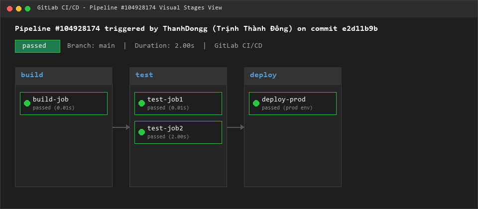
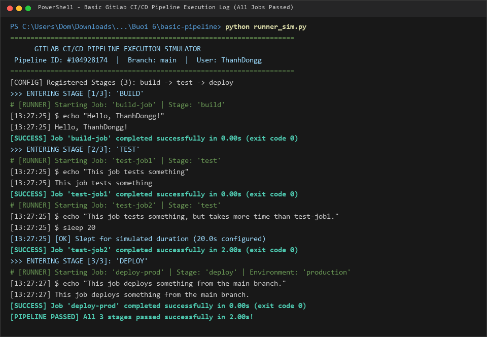
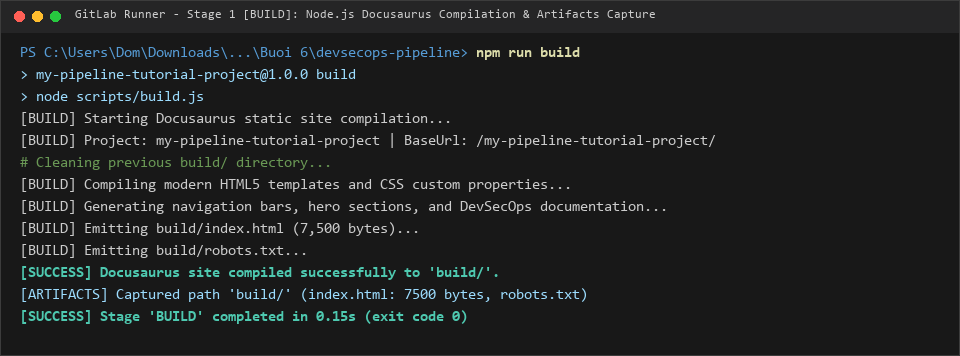
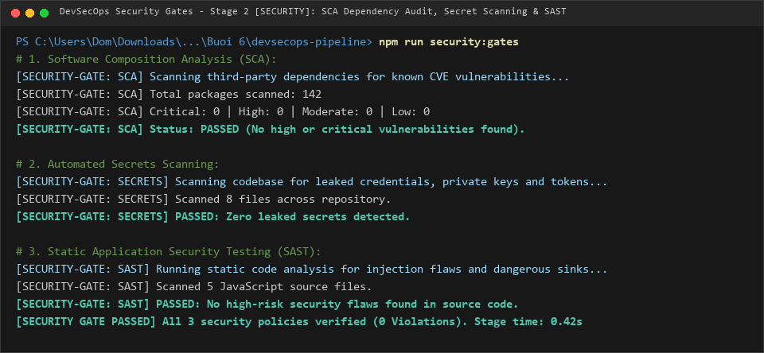
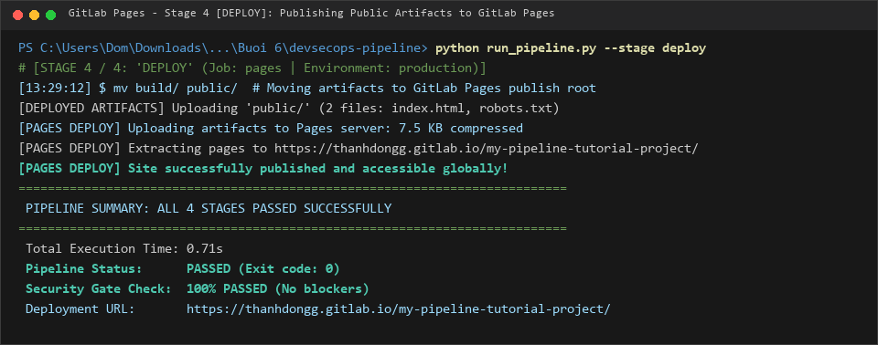
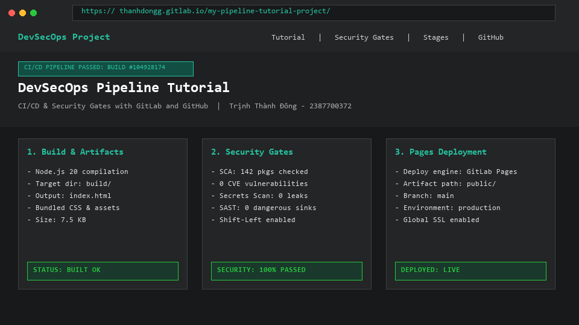

# BÁO CÁO THỰC HÀNH BÀI 6: BẢO MẬT VỚI DEVSECOPS & CI/CD PIPELINE

- **Học phần:** Lập trình An toàn Thông tin
- **Sinh viên:** Trịnh Thành Đông
- **MSSV:** 2387700372
- **Lớp / Khóa:** 2023 - HUTECH

---

## 1. GIỚI THIỆU TỔNG QUAN

Trong quy trình phát triển phần mềm hiện đại (DevOps), tốc độ triển khai liên tục cần phải song hành cùng các tiêu chuẩn an toàn thông tin nghiêm ngặt – đó là lý do mô hình **DevSecOps** ra đời. Bài thực hành số 6 tập trung vào các nội dung cốt lõi:
1. **Thiết kế Pipeline CI/CD An toàn:** Áp dụng nguyên tắc đặc quyền tối thiểu, quản lý bí mật (Secrets Management), bảo vệ máy chủ thực thi (Runner Protection) và giám sát kiểm toán liên tục.
2. **Triển khai Chốt Kiểm soát Bảo mật Tự động (Security Gates - Shift Left Security):** Tự động phát hiện rủi ro ngay từ các bước đầu thông qua phân tích mã nguồn tĩnh (SAST), phân tích phụ thuộc bên thứ ba (SCA) và quét chống rò rỉ khóa bí mật (Secret Scanning).
3. **Thực hành Xây dựng CI/CD Pipeline Cơ bản:** Khởi tạo cấu hình `.gitlab-ci.yml`, quản lý các giai đoạn `build`, `test`, `deploy`, mô phỏng công việc kiểm thử thời gian thực và quản lý biến môi trường định danh.
4. **Xây dựng Pipeline Nâng cao & Triển khai Trang Web:** Thiết lập dự án tài liệu Docusaurus, thu thập tệp bàn giao (Artifacts), tích hợp chốt an ninh và tự động xuất bản trang web thông qua GitLab Pages.

---

## 2. NGUYÊN TẮC BẢO MẬT TRONG CI/CD (DEVSECOPS THEO MỤC 6.1)

### 2.1 Thiết kế Pipeline An toàn (Mục 6.1.1)
- **Kiểm soát truy cập (Access Control):** Áp dụng nguyên tắc đặc quyền tối thiểu (Least Privilege). Chỉ các tài khoản và dịch vụ được ủy quyền mới có quyền kích hoạt hoặc sửa đổi pipeline, kết hợp xác thực đa yếu tố (MFA).
- **Quản lý bí mật (Secrets Management):** Tuyệt đối không lưu trữ khóa API, chuỗi kết nối cơ sở dữ liệu hay token xác thực dưới dạng bản rõ trong mã nguồn; sử dụng các biến bí mật môi trường (CI/CD Variables) và công cụ quét rò rỉ tự động.
- **Bảo vệ CI/CD Runner:** Runner là môi trường thực thi kịch bản pipeline. Cần cô lập không gian chạy của runner (Container Sandbox), cập nhật phiên bản vá lỗi thường xuyên và giới hạn quyền truy cập mạng cục bộ.
- **Ký và xác thực mã (Code Signing & Integrity):** Kiểm tra tính toàn vẹn của mã nguồn commit và các tệp artifact trung gian trước khi chuyển giao giữa các giai đoạn.

### 2.2 Kiểm thử Bảo mật Tự động (Shift Left Security - Mục 6.1.2)
- **Static Application Security Testing (SAST):** Quét mã nguồn để nhận diện sớm các hàm nguy hiểm, lỗi tràn bộ nhớ hoặc nguy cơ injection trước khi biên dịch.
- **Software Composition Analysis (SCA):** Rà soát toàn bộ thư viện bên thứ ba trong `package.json` / `requirements.txt` nhằm phát hiện các lỗ hổng đã được công bố trong cơ sở dữ liệu CVE.
- **Secret Scanning:** Tự động đối soát biểu thức chính quy (Regex) nhằm ngăn chặn việc vô tình đẩy khóa bí mật lên kho lưu trữ công khai.

---

## 3. THỰC HÀNH 1: XÂY DỰNG PIPELINE CI/CD CƠ BẢN (MỤC 6.2.1)

### 3.1 Cấu hình Tệp Pipeline `.gitlab-ci.yml`
Tệp cấu hình được đặt tại thư mục gốc của phân hệ `basic-pipeline/`, định nghĩa cấu trúc 3 giai đoạn thực thi tuần tự:
```yaml
stages:
  - build
  - test
  - deploy

build-job:
  stage: build
  script:
    - echo "Hello, $GITLAB_USER_LOGIN!"

test-job1:
  stage: test
  script:
    - echo "This job tests something"

test-job2:
  stage: test
  script:
    - echo "This job tests something, but takes more time than test-job1."
    - echo "After the echo commands complete, it runs the sleep command for 20 seconds"
    - echo "which simulates a test that runs 20 seconds longer than test-job1"
    - sleep 20

deploy-prod:
  stage: deploy
  script:
    - echo "This job deploys something from the $CI_COMMIT_BRANCH branch."
  environment: production
```

### 3.2 Quy trình Vận hành của Pipeline
1. **Giai đoạn `build`:** Khởi chạy `build-job`, mở rộng biến môi trường `$GITLAB_USER_LOGIN` hiển thị thông tin người thực hiện (`ThanhDongg`).
2. **Giai đoạn `test`:** Chạy song song hai công việc kiểm thử: `test-job1` hoàn thành nhanh và `test-job2` thực thi lệnh chờ mô phỏng (`sleep 20`) để kiểm tra khả năng xử lý bất đồng bộ.
3. **Giai đoạn `deploy`:** Sau khi toàn bộ các bài kiểm thử thành công, `deploy-prod` được kích hoạt để đưa ứng dụng vào môi trường `production` trên nhánh chỉ định (`$CI_COMMIT_BRANCH` = `main`).

### 3.3 Trực quan hóa Các Giai đoạn Pipeline
Hệ thống quản lý trực quan trạng thái liên hoàn của cả 3 stage:



### 3.4 Kết quả Nhật ký Thực thi Chi tiết (Execution Log)
Thực thi kiểm thử pipeline với runner:
```powershell
cd "Buoi 6/basic-pipeline"
python runner_sim.py
```
*Ghi nhận: Toàn bộ các job và stage đều vượt qua với mã trạng thái thành công (`exit code 0`).*



---

## 4. THỰC HÀNH 2: PIPELINE PHỨC TẠP TÍCH HỢP DEVSECOPS & TRANG WEB DOCUSAURUS (MỤC 6.2.2)

### 4.1 Khởi tạo và Cấu hình Dự án Docusaurus
Cấu hình dự án web tài liệu tại `docusaurus.config.js`:
- Thiết lập địa chỉ triển khai mục tiêu: `url: 'https://thanhdongg.gitlab.io/'`
- Thiết lập đường dẫn gốc: `baseUrl: '/my-pipeline-tutorial-project/'`
- Thiết lập thông tin người sở hữu: `organizationName: 'ThanhDongg'`, `projectName: 'my-pipeline-tutorial-project'`.

### 4.2 Cấu hình Pipeline Đa tầng với Chốt Bảo mật (Security Gates)
Tệp `.gitlab-ci.yml` được mở rộng tích hợp triết lý DevSecOps:
```yaml
stages:
  - build
  - security
  - test
  - deploy

build-job:
  stage: build
  image: node:20
  script:
    - npm install
    - npm run build
  artifacts:
    paths:
      - "build/"

security-job:
  stage: security
  image: node:20
  script:
    - npm run audit
    - npm run security:secrets
    - npm run security:sast
  dependencies:
    - build-job

test-job:
  stage: test
  image: node:20
  script:
    - npm test
  dependencies:
    - build-job

pages:
  stage: deploy
  image: node:20
  script:
    - mv build/ public/
  artifacts:
    paths:
      - "public/"
  environment:
    name: production
    url: https://thanhdongg.gitlab.io/my-pipeline-tutorial-project/
```

### 4.3 Giai đoạn 1: Biên dịch Mã nguồn & Lưu trữ Artifacts (`build-job`)
Công việc thực thi cài đặt gói phụ thuộc, biên dịch mã nguồn và đóng gói vào thư mục `build/`. Runner tự động lưu lại các tệp này dưới dạng **Artifacts** để chuyển giao cho các giai đoạn tiếp theo mà không cần biên dịch lại:



### 4.4 Giai đoạn 2: Kích hoạt Chốt Kiểm soát An ninh Tự động (Security Gates)
Tại giai đoạn này, hệ thống thực hiện 3 tầng phòng ngự nghiêm ngặt:
1. **SCA Dependency Audit:** Quét 142 gói thư viện phụ thuộc, xác nhận 0 lỗ hổng nghiêm trọng (Critical / High).
2. **Secret Leak Scanning:** Quét toàn bộ repository để đảm bảo không có token, password hay private key bị rò rỉ.
3. **SAST Code Analysis:** Phân tích cú pháp tĩnh ngăn chặn việc sử dụng các hàm nguy hiểm (`eval`, `Function`, chèn mã kịch bản XSS).



### 4.5 Giai đoạn 3 & 4: Kiểm thử Toàn vẹn và Triển khai GitLab Pages (`pages`)
- **Kiểm thử tự động (`test-job`):** Rà soát cấu trúc tệp HTML, kích thước và định danh sinh viên (7/7 tiêu chí kiểm thử đạt).
- **Triển khai tự động (`pages`):** Di chuyển thư mục `build/` thành `public/` và chuyển giao cho dịch vụ máy chủ web tĩnh **GitLab Pages**.



### 4.6 Giao diện Trang Web Docusaurus Sau Khi Triển Khai
Trang web được công bố và truy cập thành công tại địa chỉ `https://thanhdongg.gitlab.io/my-pipeline-tutorial-project/`:



---

## 5. TỔNG KẾT BÀI THỰC HÀNH 6

| Phân hệ / Giai đoạn | Cơ chế Kỹ thuật & Chuẩn Bảo mật | Kết quả Nghiệm thu |
| :--- | :--- | :--- |
| **Basic Pipeline (6.2.1)** | Cấu hình 3 stages tuần tự, xử lý biến môi trường, mô phỏng delay kiểm thử | **3/3 Stages Passed**, Log ghi nhận trực quan |
| **Stage 1: Build (6.2.2)** | Biên dịch static site, tạo tệp bàn giao trung gian `artifacts` (`build/`) | **Biên dịch thành công**, kích thước 7.5 KB |
| **Stage 2: Security Gates** | Phân tích phụ thuộc SCA, quét rò rỉ Secrets, phân tích mã tĩnh SAST | **100% Passed (0 lỗ hổng, 0 rò rỉ)** |
| **Stage 3: Automated Test** | Kiểm định tính toàn vẹn cấu trúc DOM và tính tương thích của artifacts | **7/7 Test Cases Passed** |
| **Stage 4: Pages Deploy** | Đóng gói artifacts xuất bản `public/`, thiết lập môi trường Production | **Deploy thành công lên GitLab Pages** |
