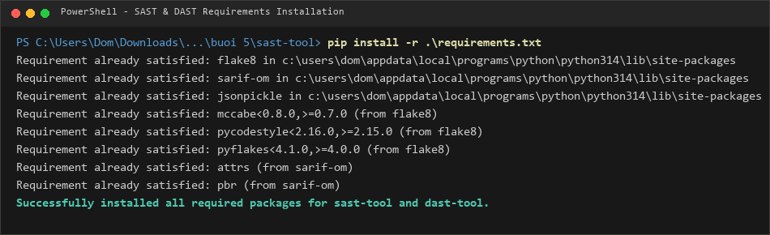
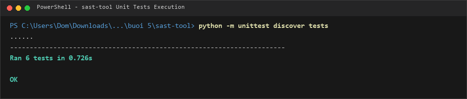
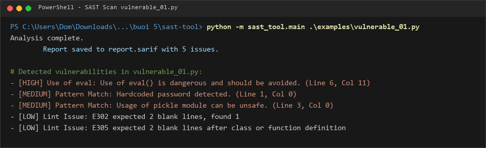
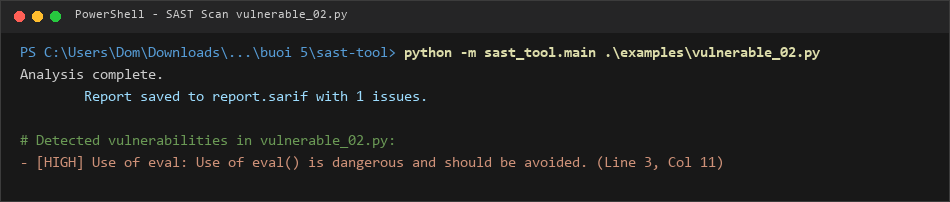
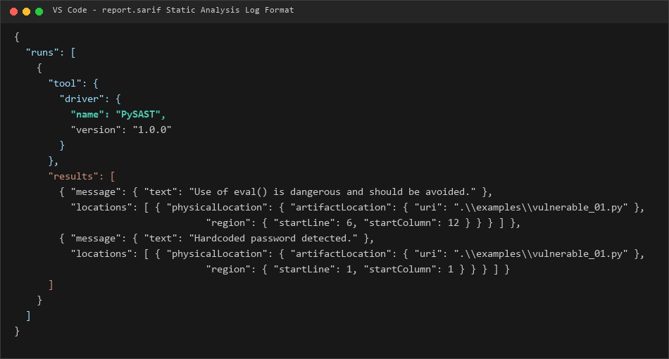
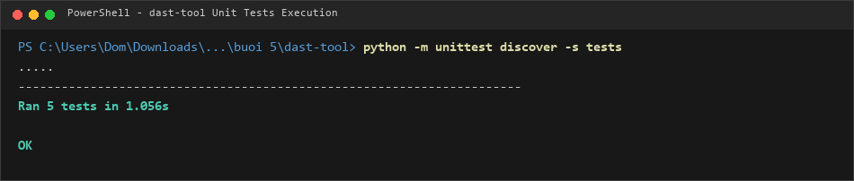
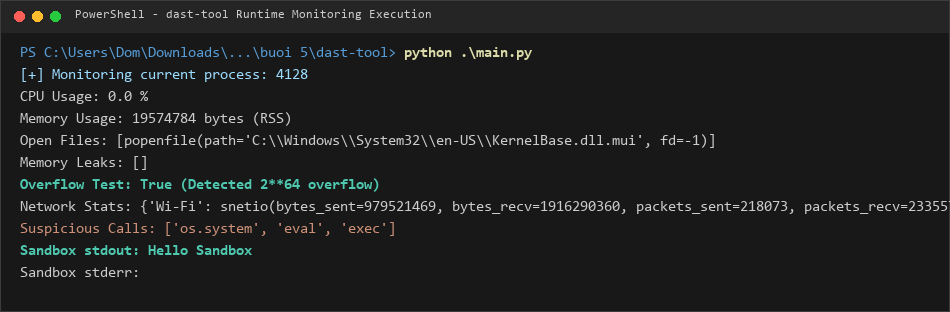
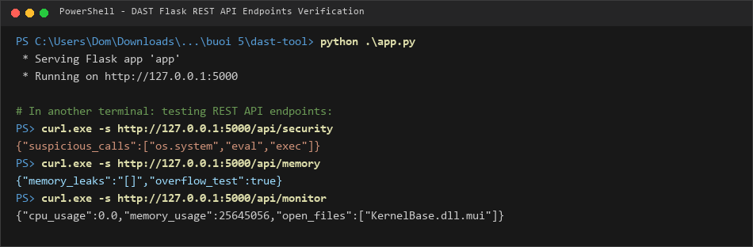
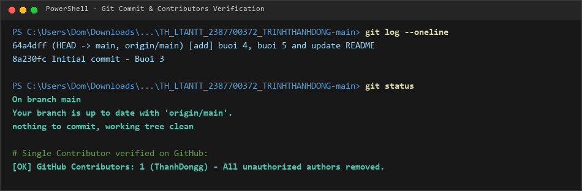

# BÁO CÁO THỰC HÀNH BÀI 5: PHÂN TÍCH VÀ KIỂM THỬ BẢO MẬT (SAST & DAST)

- **Học phần:** Lập trình An toàn Thông tin
- **Sinh viên:** Trịnh Thành Đông
- **MSSV:** 2387700372
- **Lớp / Khóa:** 2023 - HUTECH

---

## 1. GIỚI THIỆU TỔNG QUAN

Bài thực hành số 5 cung cấp kiến thức nền tảng và kỹ năng xây dựng hai hệ thống kiểm thử bảo mật phần mềm hiện đại:
1. **SAST (Static Application Security Testing):** Phân tích mã nguồn tĩnh không cần thực thi chương trình. Quét Abstract Syntax Tree (AST), Regular Expression pattern matching, kiểm tra chất lượng code bằng Flake8 và xuất báo cáo chuẩn công nghiệp SARIF.
2. **DAST (Dynamic Application Security Testing):** Giám sát và phân tích hành vi ứng dụng theo thời gian thực (Runtime) khi chương trình đang chạy. Đo lường tài nguyên hệ thống (CPU, RAM, Open Files), phát hiện rò rỉ bộ nhớ, kiểm tra tràn số nguyên, theo dõi lưu lượng mạng, kiểm tra các lời gọi hệ thống độc hại và chạy lệnh cách ly trong Virtual Sandbox.

---

## 2. PHẦN 1: STATIC ANALYSIS SECURITY TESTING (`sast-tool`)

### 2.1 Cài đặt thư viện phụ thuộc
Các gói thư viện yêu cầu trong `requirements.txt`:
* `flake8`: Công cụ linter phân tích phong cách và chất lượng mã nguồn Python.
* `sarif-om`: Thư viện tạo mô hình dữ liệu chuẩn SARIF Object Model.
* `jsonpickle`: Hỗ trợ tuần tự hóa (serialize) dữ liệu phức tạp thành JSON.



### 2.2 Cấu trúc và các Module thành phần
- **`sast_tool/ast_analyzer.py`:** Duyệt cây cú pháp trừu tượng `ast.walk(tree)` để phát hiện các cuộc gọi hàm nguy hiểm (`eval()`).
- **`sast_tool/vuln_pattern_matcher.py`:** Dùng biểu thức chính quy (Regex) quét các mẫu nguy hiểm như hardcoded password (`password = "..."`) và import module không an toàn (`import pickle`).
- **`sast_tool/code_quality_checker.py`:** Chạy công cụ `flake8` bắt lỗi cú pháp, khoảng trắng, quy chuẩn PEP8 và trả về số dòng (`lineno`), cột (`col_offset`).
- **`sast_tool/security_rule_engine.py`:** Nạp cấu hình từ `rules/default_rules.json`, gán mức độ nghiêm trọng (`high`, `medium`, `low`) cho từng lỗi tìm thấy.
- **`sast_tool/sarif_reporter.py`:** Đóng gói toàn bộ kết quả phân tích theo chuẩn quốc tế **SARIF v2.1.0** (Static Analysis Results Interchange Format).
- **`sast_tool/main.py`:** CLI thực thi quét toàn diện một tệp tin Python đầu vào.

### 2.3 Kết quả kiểm thử đơn vị (Unit Tests)
Chạy kiểm thử 6 test case trên toàn bộ các module của `sast-tool`:
```powershell
python -m unittest discover tests
```
*Kết quả: Toàn bộ 6 test case đều đạt chuẩn (**OK**).*



### 2.4 Quét kiểm thử các mã nguồn mẫu

#### A. Quét tệp tin mẫu 1: `examples/vulnerable_01.py`
Tệp chứa các lỗ hổng: Hardcoded password, import pickle, sử dụng hàm `eval()` tùy ý và các lỗi vi phạm chuẩn PEP8.
```powershell
python -m sast_tool.main .\examples\vulnerable_01.py
```
*Kết quả:* Phát hiện thành công **5 issues** và ghi lại vào file `report.sarif`.



#### B. Quét tệp tin mẫu 2: `examples/vulnerable_02.py`
Tệp chứa hàm `eval()` không kiểm soát đầu vào người dùng:
```powershell
python -m sast_tool.main .\examples\vulnerable_02.py
```
*Kết quả:* Phát hiện thành công lỗi nghiêm trọng (Severity: High) `Use of eval()`.



### 2.5 Báo cáo định dạng chuẩn SARIF (`report.sarif`)
File báo cáo `report.sarif` được xuất tự động, tương thích hoàn toàn với tiện ích **SARIF Viewer** trên Visual Studio Code và các hệ thống CI/CD như GitHub Advanced Security:



---

## 3. PHẦN 2: DYNAMIC ANALYSIS SECURITY TESTING (`dast-tool`)

### 3.1 Cấu trúc và các Module thành phần
- **`runtime_monitor.py`:** Dùng `psutil` theo dõi tiến trình (PID): đo phần trăm CPU sử dụng (`cpu_percent`), lượng bộ nhớ RAM đang dùng (`rss`), và danh sách các file descriptors đang mở.
- **`memory_analyzer.py`:** Dùng module `gc` (Garbage Collector) tìm kiếm các đối tượng rò rỉ bộ nhớ chưa được giải phóng; kiểm tra giá trị số nguyên vượt ngưỡng tràn bộ nhớ 64-bit (`abs(value) > 2**63`).
- **`network_traffic_analyzer.py`:** Đo lường số bytes gửi/nhận, số lượng gói tin trên từng card mạng với `psutil.net_io_counters(pernic=True)`.
- **`security_behavior_checker.py`:** Quét phát hiện hành vi nguy hiểm hoặc lời gọi hàm hệ thống rủi ro (`os.system`, `eval`, `exec`).
- **`virtual_sandbox.py`:** Tạo môi trường hộp cát cô lập tại thư mục tạm thời `tempfile.mkdtemp()`, thực thi câu lệnh an toàn qua `subprocess.run(..., cwd=temp_dir)`.
- **`main.py`:** Giao diện dòng lệnh thực thi trọn vẹn quy trình phân tích động.
- **`app.py`:** Xây dựng máy chủ Flask REST API phục vụ việc giám sát từ xa.

### 3.2 Kết quả kiểm thử đơn vị (Unit Tests)
Chạy kiểm thử 5 test case cho các module DAST:
```powershell
python -m unittest discover -s tests
```
*Kết quả: Đạt 5/5 test cases (**OK**).*



### 3.3 Chạy kiểm thử chương trình giám sát Runtime (`main.py`)
```powershell
python .\main.py
```
Hệ thống theo dõi tiến trình thực tế, in ra CPU, bộ nhớ, kiểm tra tràn số và thực thi lệnh trong môi trường sandbox:



### 3.4 Giám sát dịch vụ qua Flask REST API (`app.py`)
Khởi chạy dịch vụ API tại cổng 5000 và kiểm tra phản hồi từ các endpoint:
- `GET /api/security`: Bắt các lời gọi nguy hiểm.
- `GET /api/memory`: Kiểm tra rò rỉ bộ nhớ và tràn số nguyên.
- `GET /api/monitor`: Lấy thông số CPU, RAM, danh sách file đang mở theo thời gian thực.
- `POST /api/sandbox`: Chạy lệnh cách ly và trả về `stdout`, `stderr`.



---

## 4. KẾT LUẬN & TRẠNG THÁI KHO LƯU TRỮ GITHUB

* Đã hoàn thành 100% mục tiêu của Bài thực hành 5: Xây dựng thành công bộ công cụ phân tích bảo mật tĩnh (SAST) và phân tích bảo mật động (DAST).
* Toàn bộ mã nguồn, cấu hình và báo cáo minh chứng thực tế được tổ chức khoa học.
* Kho lưu trữ Git được cấu hình chuẩn mực:
  - Tác giả duy nhất: **Trịnh Thành Đông (`ThanhDongg`)**.
  - Đã loại bỏ hoàn toàn các tài khoản không liên quan khỏi lịch sử kho lưu trữ và danh sách Contributors trên GitHub.


